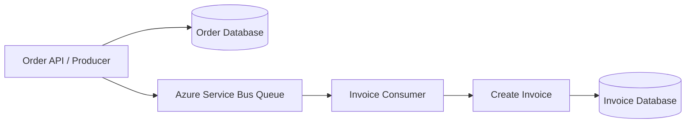
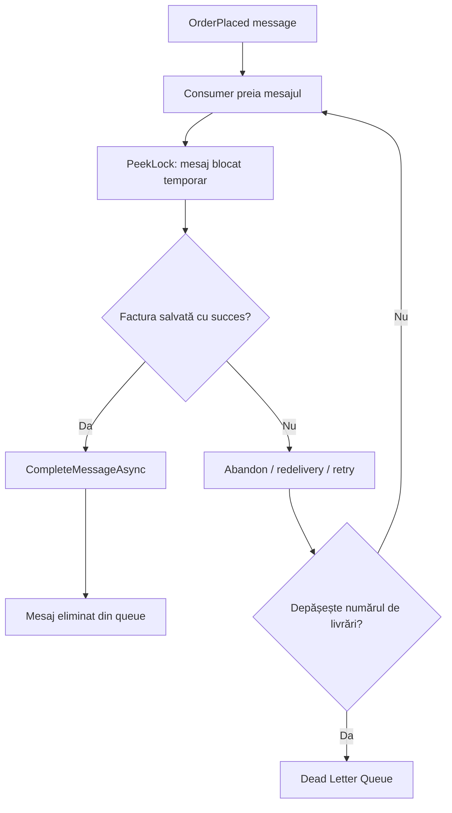
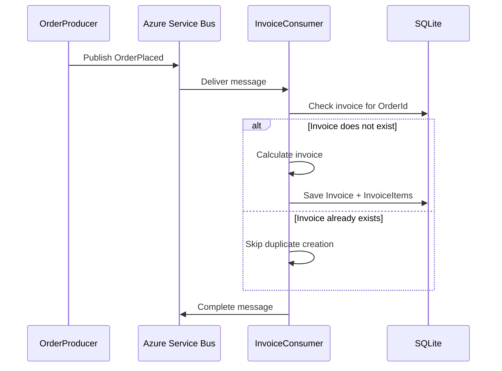

# Azure Service Bus Producer & Consumer – C# (.NET 10)

Implementare pentru un scenariu de procesare a comenzilor folosind **Azure Service Bus** și biblioteca `Azure.Messaging.ServiceBus`.

## Scenariu

1. Serviciul de comandă creează o comandă.
2. După salvarea comenzii, publică evenimentul `OrderPlaced` în Azure Service Bus.
3. Un consumator (`InvoiceConsumer`) ascultă evenimentul.
4. Consumatorul construiește factura pe baza datelor din comandă și o salvează.
5. Dacă mesajul nu poate fi procesat, Azure Service Bus îl poate livra din nou; după depășirea numărului de livrări, mesajul ajunge în Dead Letter Queue.

## 1. Arhitectură



Componente:
- **Producer** – trimite evenimentul `OrderPlaced`.
- **Queue** – reține mesajul până când un consumer îl procesează.
- **Consumer** – citește mesajul și generează factura.
- **InvoiceRepository** – salvează factura.
- **OrderPlaced** – evenimentul care transportă informațiile necesare despre comandă.

## 2. Structura soluției

Vom crea două proiecte Console separate, astfel încât producătorul și consumatorul să ruleze independent.

```text
OrderInvoiceSystem/
├── OrderProducer/
│   ├── Models/
│   │   └── OrderPlacedEvent.cs
│   ├── Program.cs
│   └── appsettings.json
└── InvoiceConsumer/
    ├── Models/
    │   ├── OrderPlacedEvent.cs
    │   └── Invoice.cs
    ├── Data/
    │   ├── InvoiceDbContext.cs
    │   └── InvoiceDbContextFactory.cs
    ├── Services/
    │   ├── InvoiceService.cs
    │   └── InvoiceRepository.cs
    ├── Program.cs
    └── appsettings.json
```

## 3. Configurarea Azure Service Bus

### 3.1. Crearea resurselor în Azure

În Azure Portal:
1. Creează un **Azure Service Bus Namespace**.
2. Alege tier-ul Standard (sau Premium).
3. În namespace, mergi la **Queues**.
4. Creează o coadă numită `orders-placed`.

### 3.2. Connection String

În Service Bus Namespace:
- Shared access policies
- Selectează policy-ul de test (sau creează unul)
- Copiază Primary Connection String

Exemplu de connection string:

```text
Endpoint=sb://my-orders-namespace.servicebus.windows.net/;
SharedAccessKeyName=RootManageSharedAccessKey;
SharedAccessKey=YOUR_SECRET_KEY
```

Nu publica connection string-ul în GitHub. Pentru un proiect real se recomandă Managed Identity și Azure RBAC; în acest exemplu folosim connection string din configurație locală.

## 4. Modelul de date – OrderPlacedEvent

Acesta este contractul evenimentului transmis prin Service Bus. Producerul și consumerul trebuie să folosească aceeași structură.

### `OrderPlacedEvent.cs`

```csharp
namespace Shared.Models;

public class OrderPlacedEvent
{
    public Guid OrderId { get; set; }
    public string CustomerId { get; set; } = string.Empty;
    public string CustomerName { get; set; } = string.Empty;
    public string CustomerEmail { get; set; } = string.Empty;
    public DateTime OrderDate { get; set; }
    public List<OrderItemEvent> Items { get; set; } = [];
    public decimal TotalAmount { get; set; }
    public string Currency { get; set; } = "RON";
}


public class OrderItemEvent
{
    public Guid ProductId { get; set; }
    public string ProductName { get; set; } = string.Empty;
    public int Quantity { get; set; }
    public decimal UnitPrice { get; set; }
}
```

Consumerul nu ar trebui să fie obligat să apeleze Order Service pentru a afla produsele, prețurile și datele clientului. Evenimentul conține snapshot-ul informațiilor relevante pentru generarea facturii.

## 5. Producer – OrderProducer

Producerul creează o comandă și publică mesajul `OrderPlaced` în Azure Service Bus.

### 5.1. Crearea proiectului

```bash
dotnet new console -n OrderProducer -f net10.0
cd OrderProducer
dotnet add package Azure.Messaging.ServiceBus
dotnet add package Microsoft.Extensions.Configuration
dotnet add package Microsoft.Extensions.Configuration.Json
```

### 5.2. Configurarea `appsettings.json`

```json
{
  "ServiceBus": {
    "ConnectionString": "Endpoint=sb://YOUR_NAMESPACE.servicebus.windows.net/;SharedAccessKeyName=YOUR_POLICY;SharedAccessKey=YOUR_KEY",
    "QueueName": "orders-placed"
  }
}
```

### 5.3. Modelul `OrderPlacedEvent.cs`

Creează folderul `Models` și adaugă fișierul:

```csharp
namespace OrderProducer.Models;

public class OrderPlacedEvent
{
    public Guid OrderId { get; set; }
    public string CustomerId { get; set; } = string.Empty;
    public string CustomerName { get; set; } = string.Empty;
    public string CustomerEmail { get; set; } = string.Empty;
    public DateTime OrderDate { get; set; }
    public List<OrderItemEvent> Items { get; set; } = [];
    public decimal TotalAmount { get; set; }
    public string Currency { get; set; } = "RON";
}

public class OrderItemEvent
{
    public Guid ProductId { get; set; }
    public string ProductName { get; set; } = string.Empty;
    public int Quantity { get; set; }
    public decimal UnitPrice { get; set; }
}
```

### 5.4. Implementarea Producer-ului – `Program.cs`

Producer-ul utilizează `ServiceBusSender` pentru a trimite mesajul în queue.

```csharp
using Azure.Messaging.ServiceBus;
using Microsoft.Extensions.Configuration;
using System.Text.Json;
using OrderProducer.Models;

var configuration = new ConfigurationBuilder()
    .AddJsonFile("appsettings.json", optional: false)
    .Build();

string connectionString = configuration["ServiceBus:ConnectionString"]!;
string queueName = configuration["ServiceBus:QueueName"]!;

await using var client = new ServiceBusClient(connectionString);
ServiceBusSender sender = client.CreateSender(queueName);

// Simulăm o comandă plasată
var order = new OrderPlacedEvent
{
    OrderId = Guid.NewGuid(),
    CustomerId = "CUST-1001",
    CustomerName = "Popescu Andrei",
    CustomerEmail = "andrei.popescu@example.com",
    OrderDate = DateTime.UtcNow,
    Currency = "RON",
    Items =
    [
        new OrderItemEvent
        {
            ProductId = Guid.NewGuid(),
            ProductName = "Laptop Lenovo",
            Quantity = 1,
            UnitPrice = 3500
        },
        new OrderItemEvent
        {
            ProductId = Guid.NewGuid(),
            ProductName = "Mouse Wireless",
            Quantity = 2,
            UnitPrice = 120
        }
    ]
};

order.TotalAmount = order.Items.Sum(item => item.Quantity * item.UnitPrice);

string json = JsonSerializer.Serialize(order);

var message = new ServiceBusMessage(json)
{
    MessageId = order.OrderId.ToString(),
    Subject = "OrderPlaced",
    ContentType = "application/json"
};
message.ApplicationProperties["EventType"] = "OrderPlaced";

await sender.SendMessageAsync(message);

Console.WriteLine("OrderPlaced event sent successfully!");
Console.WriteLine($"Order ID: {order.OrderId}");
Console.WriteLine($"Total: {order.TotalAmount} {order.Currency}");

await sender.DisposeAsync();
```

### Ce se întâmplă la trimitere?
- `ServiceBusClient` gestionează conexiunea cu Azure Service Bus.
- `CreateSender(queueName)` creează sender-ul pentru queue.
- `ServiceBusMessage` conține JSON-ul serializat.
- `MessageId` este setat la ID-ul comenzii, util pentru deduplicare.
- `Subject` identifică evenimentul.
- `ApplicationProperties` atașează metadate suplimentare.
- `SendMessageAsync()` trimite mesajul în coadă.

## 6. Consumer – InvoiceConsumer

Consumatorul este un serviciu separat, care rulează continuu și așteaptă mesaje în queue-ul `orders-placed`. Pentru persistență vom folosi **Entity Framework Core + SQLite**, ca să avem o bază de date reală, fără a necesita un server SQL separat.

### 6.1. Crearea proiectului și instalarea pachetelor

```bash
dotnet new console -n InvoiceConsumer -f net10.0
cd InvoiceConsumer
dotnet add package Azure.Messaging.ServiceBus
dotnet add package Microsoft.Extensions.Configuration
dotnet add package Microsoft.Extensions.Configuration.Json
dotnet add package Microsoft.EntityFrameworkCore.Sqlite
```

### 6.2. Configurarea `appsettings.json`

```json
{
  "ServiceBus": {
    "ConnectionString": "Endpoint=sb://YOUR_NAMESPACE.servicebus.windows.net/;SharedAccessKeyName=YOUR_POLICY;SharedAccessKey=YOUR_KEY",
    "QueueName": "orders-placed",
    "MaxConcurrentCalls": 2
  },
  "Database": {
    "ConnectionString": "Data Source=invoices.db"
  }
}
```

Consumerul folosește aceeași queue și același namespace Azure Service Bus ca producerul.

## 7. Modelele de date pentru factură

Factura este diferită de evenimentul `OrderPlaced`. Evenimentul reprezintă o comandă plasată, în timp ce factura este o entitate persistentă generată de Invoice Service.

### 7.1. `Models/Invoice.cs`

```csharp
namespace InvoiceConsumer.Models;

public class Invoice
{
    public Guid Id { get; set; }
    public Guid OrderId { get; set; }
    public string CustomerId { get; set; } = string.Empty;
    public string CustomerName { get; set; } = string.Empty;
    public string CustomerEmail { get; set; } = string.Empty;
    public DateTime IssuedAt { get; set; }
    public decimal TotalAmount { get; set; }
    public string Currency { get; set; } = "RON";
    public List<InvoiceItem> Items { get; set; } = [];
}
```

### 7.2. `Models/InvoiceItem.cs`

```csharp
namespace InvoiceConsumer.Models;

public class InvoiceItem
{
    public Guid Id { get; set; }
    public Guid InvoiceId { get; set; }
    public string ProductName { get; set; } = string.Empty;
    public int Quantity { get; set; }
    public decimal UnitPrice { get; set; }
    public decimal Subtotal { get; set; }
}
```

### 7.3. `Models/OrderPlacedEvent.cs`

Consumerul are propriul model de eveniment, fiind un serviciu independent.

```csharp
namespace InvoiceConsumer.Models;

public class OrderPlacedEvent
{
    public Guid OrderId { get; set; }
    public string CustomerId { get; set; } = string.Empty;
    public string CustomerName { get; set; } = string.Empty;
    public string CustomerEmail { get; set; } = string.Empty;
    public DateTime OrderDate { get; set; }
    public List<OrderItemEvent> Items { get; set; } = [];
    public decimal TotalAmount { get; set; }
    public string Currency { get; set; } = "RON";
}

public class OrderItemEvent
{
    public Guid ProductId { get; set; }
    public string ProductName { get; set; } = string.Empty;
    public int Quantity { get; set; }
    public decimal UnitPrice { get; set; }
}
```

## 8. Configurarea bazei de date

Vom configura EF Core pentru a salva facturile și liniile de factură în SQLite.

### `Data/InvoiceDbContext.cs`

```csharp
using InvoiceConsumer.Models;
using Microsoft.EntityFrameworkCore;

namespace InvoiceConsumer.Data;


public class InvoiceDbContext : DbContext
{
    public DbSet<Invoice> Invoices => Set<Invoice>();
    public DbSet<InvoiceItem> InvoiceItems => Set<InvoiceItem>();

    public InvoiceDbContext(DbContextOptions<InvoiceDbContext> options)
        : base(options)
    {
    }

    protected override void OnModelCreating(ModelBuilder modelBuilder)
    {
        modelBuilder.Entity<Invoice>().HasKey(i => i.Id);

        // O comandă poate genera o singură factură.
        modelBuilder.Entity<Invoice>()
            .HasIndex(i => i.OrderId)
            .IsUnique();

        modelBuilder.Entity<Invoice>()
            .HasMany(i => i.Items)
            .WithOne()
            .HasForeignKey(i => i.InvoiceId)
            .OnDelete(DeleteBehavior.Cascade);

        modelBuilder.Entity<InvoiceItem>().HasKey(i => i.Id);

        modelBuilder.Entity<Invoice>()
            .Property(i => i.TotalAmount)
            .HasPrecision(18, 2);

        modelBuilder.Entity<InvoiceItem>()
            .Property(i => i.UnitPrice)
            .HasPrecision(18, 2);

        modelBuilder.Entity<InvoiceItem>()
            .Property(i => i.Subtotal)
            .HasPrecision(18, 2);
    }
}
```

Indexul unic pentru `OrderId` ne ajută să prevenim salvarea mai multor facturi pentru aceeași comandă în cazul redelivery-ului mesajului.

## 9. InvoiceRepository – salvarea facturii

Repository-ul se ocupă de interacțiunea cu baza de date.

### `Services/InvoiceRepository.cs`

```csharp
using InvoiceConsumer.Data;
using InvoiceConsumer.Models;
using Microsoft.EntityFrameworkCore;

namespace InvoiceConsumer.Services;

public class InvoiceRepository
{
    private readonly IDbContextFactory<InvoiceDbContext> _factory;

    public InvoiceRepository(IDbContextFactory<InvoiceDbContext> factory)
    {
        _factory = factory;
    }

    public async Task<bool> ExistsForOrderAsync(Guid orderId)
    {
        await using var db = await _factory.CreateDbContextAsync();
        return await db.Invoices.AnyAsync(i => i.OrderId == orderId);
    }

    public async Task SaveAsync(Invoice invoice)
    {
        await using var db = await _factory.CreateDbContextAsync();
        db.Invoices.Add(invoice);
        await db.SaveChangesAsync();
    }

    public async Task<Invoice?> GetByOrderIdAsync(Guid orderId)
    {
        await using var db = await _factory.CreateDbContextAsync();
        return await db.Invoices
            .Include(i => i.Items)
            .FirstOrDefaultAsync(i => i.OrderId == orderId);
    }
}
```

## 10. InvoiceService – logica de generare a facturii

Acest serviciu transformă evenimentul primit în entitatea `Invoice`.

### `Services/InvoiceService.cs`

```csharp
using InvoiceConsumer.Models;

namespace InvoiceConsumer.Services;
public class InvoiceService
{
    private readonly InvoiceRepository _repository;

    public InvoiceService(InvoiceRepository repository)
    {
        _repository = repository;
    }

    public async Task<bool> CreateInvoiceAsync(OrderPlacedEvent order)
    {
        // Verificăm dacă factura există deja
        if (await _repository.ExistsForOrderAsync(order.OrderId))
        {
            Console.WriteLine($"Invoice already exists for order {order.OrderId}");
            return false;
        }

        var invoice = new Invoice
        {
            Id = Guid.NewGuid(),
            OrderId = order.OrderId,
            CustomerId = order.CustomerId,
            CustomerName = order.CustomerName,
            CustomerEmail = order.CustomerEmail,
            IssuedAt = DateTime.UtcNow,
            Currency = order.Currency,
            // Calculăm totalul din item-uri, nu din valoarea primită în eveniment
            TotalAmount = order.Items.Sum(i => i.Quantity * i.UnitPrice),
            Items = order.Items.Select(item => new InvoiceItem
            {
                Id = Guid.NewGuid(),
                ProductName = item.ProductName,
                Quantity = item.Quantity,
                UnitPrice = item.UnitPrice,
                Subtotal = item.Quantity * item.UnitPrice
            }).ToList()
        };

        await _repository.SaveAsync(invoice);

        Console.WriteLine("Invoice created successfully!");
        Console.WriteLine($"Invoice ID: {invoice.Id}");
        Console.WriteLine($"Order ID: {invoice.OrderId}");
        Console.WriteLine($"Customer: {invoice.CustomerName}");
        Console.WriteLine($"Total: {invoice.TotalAmount} {invoice.Currency}");

        return true;
    }
}
```

### De ce calculăm din nou totalul?

Nu este recomandat să avem încredere totală în valoarea `TotalAmount` transmisă de producer. Consumerul calculează totalul pe baza liniilor de comandă:

\[
Total = \sum_{i=1}^{n} Quantity_i \times UnitPrice_i
\]

## 11. Consumer – `Program.cs`

Aici conectăm Azure Service Bus, `ServiceBusProcessor`, `InvoiceService`, `InvoiceRepository` și SQLite. Consumerul utilizează `AutoCompleteMessages = false`, deci mesajul este confirmat explicit numai după ce factura a fost salvată.

```csharp
using Azure.Messaging.ServiceBus;
using InvoiceConsumer.Data;
using InvoiceConsumer.Models;
using InvoiceConsumer.Services;
using Microsoft.EntityFrameworkCore;
using Microsoft.Extensions.Configuration;
using System.Text.Json;

var configuration = new ConfigurationBuilder()
    .AddJsonFile("appsettings.json", optional: false)
    .Build();

string connectionString = configuration["ServiceBus:ConnectionString"]!;
string queueName = configuration["ServiceBus:QueueName"]!;
int maxConcurrentCalls = configuration.GetValue<int>("ServiceBus:MaxConcurrentCalls");

// Configurare DB factory
var factoryOptions = new DbContextOptionsBuilder<InvoiceDbContext>()
    .UseSqlite(configuration["Database:ConnectionString"])
    .Options;

var factory = new InvoiceDbContextFactory(factoryOptions);


// Creăm baza de date dacă nu există
await using (var db = await factory.CreateDbContextAsync())
{
    await db.Database.EnsureCreatedAsync();
}


// Instanțiem repository și service
var repository = new InvoiceRepository(factory);
var invoiceService = new InvoiceService(repository);


// Azure Service Bus
await using var client = new ServiceBusClient(connectionString);
var processor = client.CreateProcessor(
    queueName,
    new ServiceBusProcessorOptions
    {
        AutoCompleteMessages = false,
        MaxConcurrentCalls = maxConcurrentCalls,
        MaxAutoLockRenewalDuration = TimeSpan.FromMinutes(5)
    });

// Handler pentru mesaje
processor.ProcessMessageAsync += async args =>
{
    string body = args.Message.Body.ToString();
    Console.WriteLine("\nMessage received:");
    Console.WriteLine(body);

    try
    {
        var order = JsonSerializer.Deserialize<OrderPlacedEvent>(
            body,
            new JsonSerializerOptions
            {
                PropertyNameCaseInsensitive = true
            });

        if (order is null)
        {
            throw new InvalidOperationException("Could not deserialize OrderPlaced event.");
        }

        if (order.OrderId == Guid.Empty ||
            string.IsNullOrWhiteSpace(order.CustomerId) ||
            order.Items is null ||
            order.Items.Count == 0 ||
            order.Items.Any(i =>
                i.Quantity <= 0 ||
                i.UnitPrice < 0 ||
                string.IsNullOrWhiteSpace(i.ProductName)))
        {
            throw new InvalidOperationException("OrderPlaced event contains invalid data.");
        }

        // Creăm și salvăm factura
        await invoiceService.CreateInvoiceAsync(order);

        // Confirmăm mesajul doar după salvare
        await args.CompleteMessageAsync(args.Message);
        Console.WriteLine("Message completed successfully.");
    }
    catch (Exception ex)
    {
        Console.WriteLine($"Processing failed: {ex.Message}");
        // Mesajul va fi disponibil pentru retry
        await args.AbandonMessageAsync(args.Message);
    }
};

// Handler pentru erori de procesare Service Bus
processor.ProcessErrorAsync += args =>
{
    Console.WriteLine("Service Bus error:");
    Console.WriteLine(args.Exception.Message);
    Console.WriteLine($"Entity: {args.EntityPath}");
    Console.WriteLine($"Source: {args.ErrorSource}");
    return Task.CompletedTask;
};

Console.WriteLine("Invoice Consumer started...");
Console.WriteLine($"Listening on queue: {queueName}");
Console.WriteLine("Press Ctrl+C to stop.\n");

await processor.StartProcessingAsync();
var shutdown = new TaskCompletionSource();
Console.CancelKeyPress += (_, eventArgs) =>
{
    eventArgs.Cancel = true;
    shutdown.TrySetResult();
};
await shutdown.Task;

Console.WriteLine("Stopping consumer...");
await processor.StopProcessingAsync();
await processor.DisposeAsync();
Console.WriteLine("Consumer stopped.");
```

### De ce `AutoCompleteMessages = false`?

Dacă mesajul ar fi confirmat automat înainte de salvarea facturii și aplicația ar cădea în timpul procesării, mesajul ar putea fi pierdut. Cu confirmare manuală, apelăm `CompleteMessageAsync()` numai după salvare.

## 12. DbContextFactory – context separat pentru fiecare operație

`MaxConcurrentCalls = 2` permite procesarea simultană a mesajelor. Nu este sigur să folosim aceeași instanță `DbContext` pentru operații simultane, deoarece EF Core nu suportă operații concurente pe același context.

### `Data/InvoiceDbContextFactory.cs`

```csharp
using Microsoft.EntityFrameworkCore;

namespace InvoiceConsumer.Data;

public class InvoiceDbContextFactory : IDbContextFactory<InvoiceDbContext>
{
    private readonly DbContextOptions<InvoiceDbContext> _options;

    public InvoiceDbContextFactory(DbContextOptions<InvoiceDbContext> options)
    {
        _options = options;
    }

    public InvoiceDbContext CreateDbContext()
    {
        return new InvoiceDbContext(_options);
    }

    public Task<InvoiceDbContext> CreateDbContextAsync(
        CancellationToken cancellationToken = default)
    {
        return Task.FromResult(CreateDbContext());
    }
}
```

## 13. Cum rulezi aplicația

Deschide două terminale.

### Terminal 1 – Consumer (rulează primul)

```bash
cd InvoiceConsumer
dotnet run
```

Pornește listener-ul și așteaptă mesaje.

### Terminal 2 – Producer (rulează după consumer)

```bash
cd OrderProducer
dotnet run
```

Trimite o comandă în queue.

### Output Producer

```text
OrderPlaced event sent successfully!
Order ID: 45c24e4a-...
Total: 3740 RON
```

Calcul:
- Laptop Lenovo: 1 × 3500 = 3500 RON
- Mouse Wireless: 2 × 120 = 240 RON
- **Total: 3740 RON**

### Output Consumer

```text
Invoice Consumer started...
Listening on queue: orders-placed

Message received:
{
  "orderId": "...",
  "customerName": "Popescu Andrei",
  ...
}

Invoice created successfully!
Invoice ID: ...
Order ID: ...
Customer: Popescu Andrei
Total: 3740 RON

Message completed successfully.
```

## 14. Ce se salvează în baza de date?

Fișierul `invoices.db` va fi creat automat în folderul Consumer.

### Tabelul `Invoices`
| Câmp | Valoare / tip |
|---|---|
| Invoice ID | UUID |
| Order ID | UUID (unic) |
| Customer | Popescu Andrei |
| Issued At | UTC DateTime |
| Total Amount | 3740.00 |
| Currency | RON |

### Tabelul `InvoiceItems`
| Product | Quantity | Unit Price | Subtotal |
|---|---:|---:|---:|
| Laptop Lenovo | 1 | 3500 | 3500 |
| Wireless Mouse | 2 | 120 | 240 |

## 15. Ce se întâmplă dacă Consumer-ul cade?



| Situație | Comportament |
|---|---|
| Factura salvată | `Complete` |
| Eroare la procesare | `Abandon` |
| Consumer-ul se oprește înainte de confirmare | Lock-ul expiră și mesajul devine disponibil din nou |
| Mesajul eșuează repetat | Ajunge în DLQ după limita configurată |
| Mesajul este redeliverat | Consumerul verifică dacă factura există deja |

## 16. Idempotency – evitarea facturilor duplicate

În sistemele distribuite, un mesaj poate fi livrat de mai multe ori. Exemplu:
1. Consumerul primește comanda.
2. Salvează factura în baza de date.
3. Aplicația cade înainte de `CompleteMessageAsync()`.
4. Service Bus livrează din nou mesajul.
5. Consumerul găsește factura deja salvată.

Implementarea protejează acest scenariu prin:
- verificarea existenței facturii pe baza `OrderId`;
- index unic în baza de date pentru `OrderId`;
- verificarea existenței înainte de creare.

În production, verificarea și inserarea trebuie tratate atomic pentru a evita race conditions între instanțe. Indexul unic din DB este protecția finală, dar conflictul trebuie gestionat explicit.

## 17. Configurarea Queue-ului

În Azure Portal, pentru `orders-placed`, valori recomandate pentru demo:

| Proprietate | Valoare recomandată |
|---|---|
| Queue name | `orders-placed` |
| Max delivery count | `5` |
| Lock duration | `1 minute` |
| Message TTL | `1 day` |
| Requires duplicate detection | Optional |
| Dead lettering on expiration | Enabled |

Duplicate detection la nivel de broker poate ajuta, dar nu înlocuiește idempotency la nivelul bazei de date.

## 18. Rezumatul fluxului de business



## 19. Biblioteci și documentație

- [Azure.Messaging.ServiceBus – documentație .NET](https://learn.microsoft.com/en-us/dotnet/api/overview/azure/messaging.servicebus-readme?view=azure-dotnet)
- [Azure Service Bus – Queue Quickstart](https://learn.microsoft.com/en-us/azure/service-bus-messaging/service-bus-dotnet-get-started-with-queues)
- [EF Core SQLite provider](https://learn.microsoft.com/en-us/ef/core/providers/sqlite/)

**Rezultatul:** producer și consumer independenți, comunicare asincronă prin Azure Service Bus, generare de facturi, salvare în baza de date, confirmare explicită, retry și protecție de bază împotriva facturilor duplicate.

Un upgrade ulterior ar fi transformarea Consumerului într-un **.NET Worker Service cu Dependency Injection, logging, EF Core migrations și retry policies**, în loc de un Console Application simplu.
